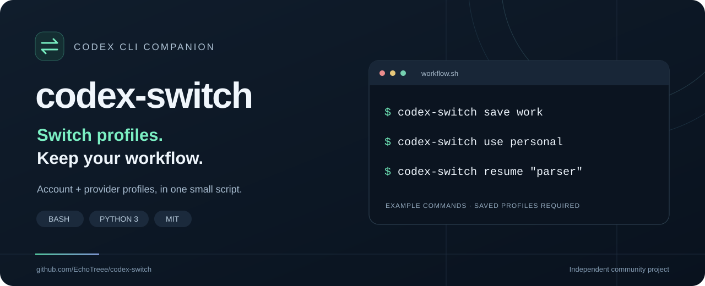

<p align="center">
  
</p>

# codex-switch

**Multiple Codex accounts. Shared local conversations. Parallel worktrees.**

[](LICENSE)
[](#requirements)
[](https://github.com/EchoTreee/codex-switch/actions/workflows/checks.yml)

**English** · [简体中文](README.zh-CN.md)

[Parallel workflow](#parallel-work-one-home-per-account) · [Official accounts](#multiple-official-accounts) · [Official + relay](#official-accounts-and-relays) · [Install](#install) · [Commands](#commands) · [Contribute](CONTRIBUTING.md)

Moving between a personal account, a work account, and a custom provider? Give each setup a name. `codex-switch` saves the local authentication and configuration files together, then restores the pair you choose — and each account can run in its own isolated home at the same time.

**One `CODEX_HOME` per account: authentication files stay apart, conversation history stays shared.** Homes created by `run` symlink the session store back to the shared `~/.codex`, so switching accounts or providers still continues the same local conversation. Choose the [official-account workflow](#multiple-official-accounts) or the [official + relay workflow](#official-accounts-and-relays).

```bash
codex-switch relogin --device-auth work  # log in an account and save it as a profile
codex-switch run work                    # start codex in its own home; run several at once
codex-switch use personal                # switch the shared home (IDE / desktop app)
```

## Six reasons to use codex-switch

1. **Multiple accounts on one machine.** Give each account its own `CODEX_HOME` (`run`) with its own authentication files. Several terminals can run at once without picking up each other's account, and nothing needs to be switched by hand.
2. **One local conversation history.** An isolated home symlinks `sessions/` back to the shared `~/.codex`, so accounts and compatible providers continue the same conversation, including official ↔ relay transitions. No duplicate history store or synchronization step is needed.
3. **Switch files, without logging out.** Restore `auth.json` + `config.toml` instead of manually repeating login. The switcher never calls `codex logout` or a token-revocation endpoint. This does not prevent credentials from expiring or being rotated elsewhere.
4. **Official accounts and custom providers together.** Save working API-key provider configurations, including relay `base_url` settings, alongside official profiles. Keys supplied through environment variables must be managed separately.
5. **Separate worktrees for parallel code changes.** Give each agent its own branch and Git worktree so edits stay in separate working directories. Worktrees isolate code files, not authentication or external services.
6. **One script, minimal setup.** Bash + Python 3's standard library and standard Unix tools; no extra Python packages, build step, or background service. Install to `~/.local/bin` and use it.

## Choose your workflow

| Question | Multiple official accounts | Official account + relay |
| --- | --- | --- |
| What changes? | Login identity; configuration can also differ. | Authentication, provider endpoint, and possibly model. |
| Provider ID | Normally `openai` for both accounts. | For example, `openai` ↔ `zipwuu`. |
| What happens to local history? | Shared: each isolated home symlinks `sessions/` back to `~/.codex`. | Shared the same way. |
| How do I resume? | `run <account> resume` to continue an `openai` session in that account's home. | Find with `codex-switch sessions`, then `run <profile> resume <keyword or id>` to use that profile's provider/model. |
| Why the different steps? | Changing the account alone does not cross a provider boundary. | Finding the session and choosing its execution provider are separate concerns. |

One Bash script with Python's standard library. No build step, background service, or separate account with this project.

> **Scope:** `run` keeps authentication files apart and is the main way to work in parallel. The shared home (`use`) holds a single login, so several processes using it still race on refreshes; tools that must share `~/.codex` (IDE extension, desktop app) should not fight another terminal over the same account.

## Parallel work: one home per account

**Day-to-day parallelism uses `run`: every account gets its own `CODEX_HOME`, authentication files never collide, and conversation history stays shared.**

1. **Prepare accounts.** For a new account, run `codex-switch relogin --device-auth <name>`. It logs in inside a scratch home, creates or overwrites that profile, and does not revoke tokens other sessions are using. The older `codex login` + `save` detour is unnecessary.
2. **Open one terminal per account.** Start each with `codex-switch run <account>`. Several accounts can run at the same time without cross-talk. Give each agent its own Git worktree to separate code files.
3. **Re-login other accounts while tasks run.** `relogin` only touches a scratch home, so running slots are unaffected — but do not relogin a slot that is itself running.
4. **Recover in order when a token dies.** `relogin --device-auth <account>` → `daemon-restart <account>` → `run <account>`. Skipping `daemon-restart` leaves the login page in place: a daemon reads `auth.json` once at startup and keeps the old token in memory.
5. **Look up history without launching another session.** `codex-switch sessions` only reads the index. `codex-switch resume` and `run <account> resume` both start a new Codex process and still need the intended account; they are not authentication-free operations.

On startup `run` compares the isolated home's `auth.json` with the profile's, keeps the newer one, and writes it back to the profile, so tokens rotated during a previous run are not lost. Sequential switching on the shared home (`use` + `codex`) still works, but use it only when you do not need concurrency, or for tools that must share `~/.codex`.

See the [full parallel guide](docs/parallel.md) for two-terminal worktree commands, the three failure modes of the shared home, and recovery. A retained local history and reliable authentication are separate requirements. Avoid resuming the same conversation simultaneously from multiple writers.

## Recommended companion: herdr

Want to keep parallel agents in one terminal interface? Try [herdr](https://github.com/herdrdev/herdr), a TUI for managing coding-agent terminals and seeing which panes need attention.

| Tool | Role in this workflow |
| --- | --- |
| **herdr** | Organize agent panes and tabs; keep an overview of running tasks. |
| **codex-switch** | Select saved account/provider profiles and continue local conversations. |
| **Git worktree** | Give each agent a separate code directory and branch. |

Open a pane per worktree and start `codex-switch run <account>` inside it. This is an optional companion workflow; herdr is not required by codex-switch.

Detaching the herdr client can leave its server and agent processes running. A server restart is different: restoring an agent launches a new process and requires the intended authentication. See the [herdr setup notes](docs/parallel.md#using-herdr-as-your-terminal-interface) and [herdr's quick start](https://herdr.dev/docs/quick-start/).

## Multiple official accounts

**Use this for two or more official accounts that normally share the `openai` provider.** The main task is switching authentication while keeping your local work available.

### Log in each account once

After [installation](#install), log in the accounts you need. `relogin` logs in inside a scratch home and saves the result straight into a profile, so it never revokes the shared home's session or another running slot's tokens:

```bash
# Log in account A (a new name creates the profile)
codex-switch relogin --device-auth official-work

# Log in account B
codex-switch relogin --device-auth official-personal
```

Pick the intended account in the browser page. You can still `codex-switch use <name>` and `save` to overwrite an existing profile, but `relogin` is simpler and does not disturb running slots.

### Run and continue

```bash
# One home per account; open as many terminals as you need
codex-switch run official-work

# A second terminal runs the other account without cross-talk
codex-switch run official-personal

# Continue a session as a specific account (args pass through to codex)
codex-switch run official-work resume "parser"
```

When a tool must share `~/.codex` (an IDE extension or desktop app, for example), switch the shared home instead:

```bash
codex-switch use official-work
codex resume
```

For an exact conversation, use `codex resume "your-session-id"` after replacing the ID. Or use `codex-switch sessions` and `codex-switch resume "parser"` to search by title and explicitly apply the active model settings.

### Why native resume is usually enough

The login identity changes, but both accounts normally use `model_provider = "openai"`. An existing `openai` session therefore does not need a different provider just because you changed accounts. The local history remains under the same home; switching accounts does not create a second history store.

If the session was previously resumed through a relay, its saved provider may now be different: use the [mixed-provider workflow](#official-accounts-and-relays). Model access can also differ between official accounts; select an available model when needed. Native picker working-directory filters still apply.

The `use` example above changes the single login that the shared home holds. To run several accounts at once, use [`run` and its isolated homes](#parallel-work-one-home-per-account): authentication files stay separate and session history is still shared.

## Official accounts and relays

**Use this when the provider changes as well as the account.** Keep the same local history, find it without a provider filter, then explicitly choose the provider/model used to continue.

### Save both working configurations

```bash
# Start from a verified official login and configuration.
codex-switch save official

# Configure and verify the relay in Codex, then save it immediately.
codex-switch save relay
```

Before the second `save`, actually configure the relay's provider ID, endpoint, model, and authentication in Codex and verify that it works. The name `relay` does not configure a provider automatically. File snapshots do not switch environment-based API keys; set those separately for the selected provider. See [custom providers](docs/usage.md#custom-providers).

### The history is already shared

When both setups use the same `CODEX_HOME` (default `~/.codex`), they use the same local storage:

- `~/.codex/sessions/` — rollout JSONL conversation records.
- `~/.codex/state_5.sqlite` — the session index used by this script.

The files are not split into separate official-account and relay histories. A session can have provider metadata while its history remains in that same directory. Switching profiles leaves these records in place.

### Why a conversation can seem to disappear

In the author's reported workflow, Codex's `/resume` picker filters by `model_provider`: the `openai` view shows official-provider sessions, while the `zipwuu` view shows that relay's sessions. Without an override, resuming also uses the session's saved provider. A missing picker entry can therefore be a filtered view, rather than lost history. Picker behavior is version-dependent; working-directory filters can also hide sessions.

### Continue in either direction

First save and verify both profiles in the same home. Here, `relay` and `official` are saved profile names; choose a title keyword matching exactly one CLI session.

```bash
codex-switch sessions                      # list CLI / exec / VS Code sessions across providers
codex-switch run relay resume "parser"     # continue in the relay profile's own home
codex-switch run official resume "parser"  # continue the same conversation as an official account
```

The underlying commands look like this; replace the session ID and use models available on each provider. `zipwuu` is an example configured provider ID, not a built-in profile or an endorsement.

```bash
SESSION_ID="your-session-id"

# Via the relay
codex resume "$SESSION_ID" -c 'model_provider="zipwuu"' -c 'model="gpt-5.6-terra"'

# After exiting, via the official provider
codex resume "$SESSION_ID" -c 'model_provider="openai"' -c 'model="gpt-6-astra"'
```

The author reports that successful cross-provider resume writes the selected provider back to the local index, effectively “re-pointing” that session. A later override can point it back while continuing its existing local history. **Codex performs that writeback; `codex-switch` only reads the index and forwards the overrides.** This persistence behavior is not independently verified across Codex versions. See [the detailed mechanism](docs/usage.md#shared-history-and-provider-writeback).

This workflow requires a shared home, a compatible session format, and a provider/model that can resume the conversation. Existing history is retained locally; that does not guarantee every historical token fits the model's context window. Separate homes or machines do not automatically share history.

**Remember: find with `codex-switch sessions`; continue with `codex-switch resume`.**

## Requirements

- Bash, Python 3, and standard Unix command-line tools.
- [OpenAI Codex CLI](https://github.com/openai/codex), already installed and configured.
- Git for the installation below.
- Both `auth.json` and `config.toml` in your Codex home before the first `save`.

Linux is the primary target. On Windows, use a Linux environment such as WSL; these commands are Bash commands. The included workflow runs smoke tests on Linux and macOS, but mock tests do not establish live Codex compatibility. Terminal messages are currently in Chinese.

On macOS, Codex can keep the login in the system Keychain instead of `auth.json` (see `cli_auth_credentials_store` in `config.toml`). When that happens, switching profiles changes files but not the account. `codex-switch` warns when it detects this; set `cli_auth_credentials_store = "file"` and run `codex login` again to fix it.

`sessions` and `resume` depend on Codex's local `state_5.sqlite` database and `threads` schema. They may need updates when Codex changes its storage format. See [compatibility](docs/usage.md#compatibility).

## Install

```bash
git clone https://github.com/EchoTreee/codex-switch.git
cd codex-switch
bash install.sh
export PATH="$HOME/.local/bin:$PATH"
codex-switch help
```

The installer copies the script to `~/.local/bin`. Keep the `PATH` line in your shell's startup file if that directory is not already on your path (on macOS the default shell is zsh, so add it to `~/.zshrc`). It does not require `sudo`.

<details>
<summary>Custom directory, updates, and uninstall</summary>

```bash
# Install into a directory already on your PATH
bash install.sh /your/bin/directory

# Update from inside this checkout
git pull --ff-only
bash install.sh

# Remove the default installed command
rm "$HOME/.local/bin/codex-switch"
```

Uninstalling the command preserves Codex data and saved profiles. The installer needs the main script beside it; run it from a clone, rather than piping `install.sh` from a URL.

</details>

## Quick start

```bash
# 1. Log in the first account (creates the profile; pick the account in the browser)
codex-switch relogin --device-auth work

# 2. Start Codex in that account's own home
codex-switch run work

# 3. Log in a second account and run it in another terminal at the same time
codex-switch relogin --device-auth personal
codex-switch run personal
```

`run` creates `~/.codex-homes/<name>` holding that account's own `auth.json` and `config.toml`, and symlinks everything else back to the shared `~/.codex`, so session history stays shared. When a tool must use `~/.codex` itself (an IDE extension or desktop app), switch the shared home with `codex-switch use <name>`.

To keep an existing login instead: run `codex-switch save work` from the shared home. After an external `codex login` or a manual provider change, `save <name>` before switching away so the profile is not overwritten.

```bash
codex-switch list             # saved profiles; * marks the recorded active one
codex-switch status           # local paths, account ID, and provider
codex-switch sessions         # local CLI / exec / VS Code sessions
codex-switch resume "parser"  # resume by title keyword or session ID
```

Recovery order after a token is revoked (401 / login page again):

```bash
codex-switch relogin --device-auth work   # log in again in a scratch home
codex-switch daemon-restart work          # stop the daemon still caching the old token
codex-switch run work                     # start with the new authentication
```

See [provider setup, recovery, and troubleshooting](docs/usage.md) for the next steps.

## Commands

| Command | Behavior |
| --- | --- |
| `save <name>` | Save current authentication and configuration; an existing name is overwritten. |
| `use <name>` | Refresh the previously active profile, back up current files, and restore the named profile. |
| `relogin <name>` | Run Codex login in a scratch home and save the result into the profile; the shared home's auth/config are left untouched. |
| `relogin --device-auth <name>` | Use Codex's device-code login flow. The flag comes before the name. |
| `run <name> [codex args...]` | **Main workflow**: launch Codex in an isolated per-account `CODEX_HOME` (own auth/config, shared sessions) for concurrent accounts; reuses and writes back newer tokens from the previous run. |
| `sync <name>` | Manually copy the latest authentication from the `run`-created isolated home back into its profile (`run` also does this automatically at startup when the home's copy is newer). |
| `daemon-restart <name>` | Stop the isolated home's app-server daemon that still caches the old authentication, so the next `run` starts fresh (for when `run` shows a login page right after `relogin`). |
| `list` | Show saved profiles and the recorded active profile. |
| `status` | Show local file locations and account/provider metadata. |
| `sessions` | List local sessions from the expected SQLite schema. |
| `resume <keyword or id>` | Resume one matching CLI / VS Code session (by title keyword or session ID) with current provider/model overrides. |
| `delete <name>` | Remove the saved profile; leave active Codex files untouched. |
| `help` | Show built-in help. |

Prefix each command with `codex-switch`. Use simple profile names such as `work`, `personal`, or `relay-dev`; names are currently treated as paths, without validation.

## How it works

```text
Shared trajectory (`use`)

Saved profiles                         Active Codex home
~/.config/codex-switch/profiles/        ~/.codex/
├── work/                              ├── auth.json
│   ├── auth.json          use work ──► ├── config.toml
│   └── config.toml                     ├── sessions/       (left in place)
└── personal/                          └── state_5.sqlite  (left in place)
    ├── auth.json
    └── config.toml

Isolated trajectory (`run`)

~/.codex-homes/work/
├── auth.json      (real file, refreshed during the run)
├── config.toml    (real file)
└── sessions/ ...  (symlinks back to the shared ~/.codex)
```

| Variable | Default | Purpose |
| --- | --- | --- |
| `CODEX_HOME` | `~/.codex` | Authentication, configuration, and session location. |
| `CODEX_SWITCH_DIR` | `~/.config/codex-switch` | Saved profiles, active-profile marker, and previous snapshot. |
| `CODEX_SWITCH_HOMES_DIR` | `~/.codex-homes` | Root for the isolated per-account homes created by `run`. |

Saved profiles and backups contain **unencrypted credentials**. Keep them private. Environment-based API keys and OS keychain credentials are not captured by copying these files. The switcher does not add telemetry or cloud synchronization; commands that invoke Codex retain Codex's own behavior. Read the [security notes](SECURITY.md) before sharing logs or screenshots.

## Contribute

Bug reports, compatibility reports, clearer examples, and translations are welcome. Start with [CONTRIBUTING.md](CONTRIBUTING.md), [open an issue](https://github.com/EchoTreee/codex-switch/issues/new/choose), or review the [roadmap](ROADMAP.md).

If this saves you time, a star helps others discover it. Sharing a reproducible workflow is especially useful.

## License

[MIT](LICENSE) © 2026 EchoTreee. An independent community project, not affiliated with or endorsed by OpenAI.
