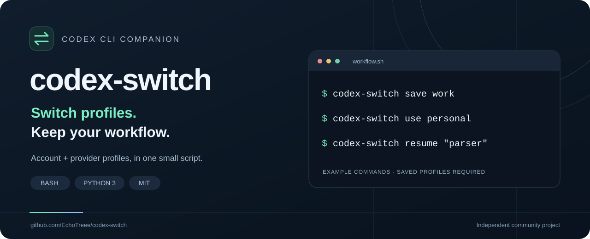

<p align="center">
  
</p>

# codex-switch

**一台机器，多账号协作；共享本地对话，配合 worktree 并行开发。**

[](LICENSE)
[](#运行要求)
[](https://github.com/EchoTreee/codex-switch/actions/workflows/checks.yml)

[English](README.md) · **简体中文**

[并行工作流](#并行工作流每个账号一个独立-home) · [官方多账号](#官方多账号使用) · [官方与中转站混用](#官方与中转站混合使用) · [安装](#安装) · [命令速查](#命令速查) · [参与贡献](CONTRIBUTING.md)

个人账号、工作账号、自定义 provider，每次切换都要手动整理登录文件和配置？给每套环境起个名字，把本地登录文件和 `config.toml` 一起保存，需要时一起恢复；多个账号还能各自用一个独立 home 同时运行。

**每个账号一个独立 `CODEX_HOME`，登录文件互不干扰，会话历史仍然互通。** `run` 创建的独立 home 会把会话记录软链回共享的 `~/.codex`，所以换账号、换线路都能接着同一个本地对话继续工作。下面分别介绍[官方多账号](#官方多账号使用)和[官方与中转站混用](#官方与中转站混合使用)。

```bash
codex-switch relogin --device-auth work  # 登录一个账号并存成 profile（不打扰其它会话）
codex-switch run work                    # 用它的独立 home 启动 codex，可多账号同时跑
codex-switch use personal                # 切换共享 home（IDE / 桌面端等共用的那份）
```

## 六个核心优势

1. **一台机器，多账号并行。** 每个账号一个独立 `CODEX_HOME`（`run`），各自持有登录文件，多个终端同时跑也不串号，不需要在终端之间来回切换。
2. **账号间共享本地对话。** 独立 home 会把 `sessions/` 软链回共享的 `~/.codex`，跨账号、跨兼容 provider（官方 ↔ 中转站）继续同一条对话，无需复制或同步两套历史。
3. **文件切换，不主动退出登录。** 恢复 `auth.json` + `config.toml`，减少重复登录操作。切换器不调用 `codex logout`，也不调用 token 吊销接口；但这不阻止凭据到期或被其他进程轮换。
4. **官方账号与自定义 provider 统一管理。** 已配置可用的 API-key 中转站及其 `base_url` 可一起存成 profile。环境变量形式的 key 需另行管理。
5. **配合 Git worktree 并行开发。** 每个 agent 使用独立分支和工作目录，避免直接覆盖彼此的代码文件；认证文件和外部服务仍需单独考虑。
6. **单文件脚本，轻量即用。** 只需 Bash、Python 3 标准库及常见 Unix 工具，无额外 Python 包、构建步骤或常驻服务，安装到 `~/.local/bin` 即可使用。

## 先选你的使用场景

| 对比点 | 官方多账号使用 | 官方与中转站混合使用 |
| --- | --- | --- |
| 切换的是什么？ | 登录身份，配置也可以不同。 | 登录方式、provider 线路，可能还有模型。 |
| provider 是否变化？ | 通常都为 `openai`。 | 例如 `openai` ↔ `zipwuu`。 |
| 历史是否共享？ | 共享：独立 home 把 `sessions/` 软链回 `~/.codex`。 | 同样共享。 |
| 怎么继续会话？ | `run <账号> resume` 用该账号的独立 home 恢复 `openai` 会话。 | 用 `codex-switch sessions` 查找，再用 `run <名字> resume <关键词或ID>` 带入该 profile 的线路和模型。 |
| 为什么方式不同？ | 只换账号，不会因此跨越 provider。 | 找到会话与决定用哪条线路恢复，是两个不同步骤。 |

一个 Bash 脚本，搭配 Python 标准库。不需要构建，也不需要常驻服务或注册本项目的账号。

> **使用边界：**`run` 的独立 home 把认证文件分开，是并行运行的主要方式。共享 home（`use`）只有一个登录态，多个进程共用它仍有刷新竞态；共用它的工具（如 IDE 扩展、桌面端）请避免与别的终端抢同一个账号。

## 并行工作流：每个账号一个独立 home

**日常并行用 `run`：每个账号有自己的 `CODEX_HOME`，登录文件互不干扰，会话历史仍然共享。**

1. **准备账号。** 新账号直接 `codex-switch relogin --device-auth <名字>`：在隔离的临时 home 里登录，会创建或覆盖该 profile，不吊销其它会话正在用的 token。中间还要 `codex login` 的旧做法已经不需要了。
2. **各开各的终端。** 每个终端 `codex-switch run <账号>`，可以在同一时间跑多个账号、互不串号。给每个 agent 准备独立 worktree 隔离代码文件。
3. **运行期间可以照常重登别的账号。** `relogin` 只在临时 home 里操作，不会影响正在运行的槽位；但同一个槽位正在跑时不要对它自己 `relogin`。
4. **token 失效后按顺序恢复。** `relogin --device-auth <账号>` → `daemon-restart <账号>` → `run <账号>`。少了 `daemon-restart` 那一步会继续弹登录页：daemon 只在启动时读一次 `auth.json`，内存里还是旧 token。
5. **查记录与续会话分开。** `codex-switch sessions` 只读索引，可以用来查找历史；`codex-switch resume` 或 `run <账号> resume` 都会启动新的 Codex 进程，仍然需要正确的登录身份，不能当成与 token 无关的操作。

`run` 在启动时会比较独立 home 与 profile 里的 `auth.json`，取较新的那份并回写 profile，所以上一次运行轮换过的 token 不会丢。共享 home 下的顺序切换方式（`use` + `codex`）仍然可用，但只建议在没有并发需求时使用，或用于必须共用 `~/.codex` 的工具。

完整的双终端 worktree 示例、共享 home 的三个风险与收尾步骤，见[并行工作流与风险指南](docs/parallel.zh-CN.md)。本地历史还在与登录态可用，是两件不同的事；也应避免多个进程同时恢复并写入同一条对话。

## 推荐搭配：herdr

想把多个并行 agent 放进一个终端界面统一查看？推荐试试 [herdr](https://github.com/herdrdev/herdr)：一个管理编程 agent 终端的 TUI，方便查看各窗格的任务状态，找到需要你处理的任务。

| 工具 | 在这套工作流中的分工 |
| --- | --- |
| **herdr** | 管理 agent 的窗格、标签页，集中查看运行中的任务。 |
| **codex-switch** | 选择保存的账号与 provider 配置，接续本地对话。 |
| **Git worktree** | 给每个 agent 独立的代码目录与分支。 |

每个 worktree 开一个窗格，在窗格内 `codex-switch run <账号>` 启动，就能把这套工作流集中在一个界面里。herdr 是可选搭配；codex-switch 不依赖它。

断开 herdr 客户端可以让后台服务和 agent 进程继续运行；服务重启后的会话恢复则会启动新进程，仍需选择正确身份。详细操作见[herdr 搭配说明](docs/parallel.zh-CN.md#用-herdr-集中管理终端)和 [herdr 快速入门](https://herdr.dev/docs/quick-start/)。

## 官方多账号使用

**适合两个或多个官方账号，provider 通常都为 `openai` 的场景。** 重点是切换登录身份，同时保留本地已有工作。

### 先分别登录每个账号

完成[安装](#安装)后，逐个登录要用的官方账号。`relogin` 在隔离的临时 home 里登录并直接存成 profile，不会吊销共享 home 或其它槽位的 token：

```bash
# 登录官方账号 A（名字不存在会自动创建 profile）
codex-switch relogin --device-auth official-work

# 登录官方账号 B
codex-switch relogin --device-auth official-personal
```

浏览器页面里选对账号。已有 profile 也可以先 `codex-switch use <名字>` 切到共享 home 再 `save` 覆盖，但 `relogin` 更省事，也不会影响正在运行的槽位。

### 日常运行与续聊

```bash
# 每个账号一个独立 home，可以同时开多个终端
codex-switch run official-work

# 另一个终端同时跑另一个账号，互不串号
codex-switch run official-personal

# 指定账号续某条会话（run 后面的参数原样传给 codex）
codex-switch run official-work resume "parser"
```

如果某个工具必须共用 `~/.codex`（例如 IDE 扩展或桌面端），再用 `codex-switch use <名字>` 切换共享 home：

```bash
codex-switch use official-work
codex resume
```

要精确恢复，可以直接把会话 ID 传给 `codex-switch resume "your-session-id"`，或填入原生 `codex resume`。也可以用 `codex-switch sessions` 查找，再用 `codex-switch resume "parser"` 按标题恢复，并显式采用当前 profile 的模型设置。

### 为什么通常直接 resume 就够了？

变化的是登录身份，两个账号的 `model_provider` 通常仍为 `openai`。因此，对于原本就是 `openai` 的会话，换官方账号并不要求更换 provider。本地历史也仍在同一个 home 中，不会因为账号不同而另建一套。

如果这条会话之前已经通过中转站恢复过，保存的 provider 可能已不同，应使用下面的[混合使用方式](#官方与中转站混合使用)。不同官方账号的模型权限也可能不同，需要时选择可用模型；原生选择器的工作目录过滤仍可能影响可见性。

上面的 `use` 示例只切换共享 home 的那一份登录态。需要同时跑多个账号时用 [`run` 的独立 home](#并行工作流每个账号一个独立-home)：认证文件各自分开，会话历史仍然共享。

## 官方与中转站混合使用

**适合账号之外，provider 线路也会变化的场景。** 同一个 Codex home 里，历史本来就是本地同一份；查找时绕过 provider 过滤，恢复时通过 `-c` 明确采用当前线路和模型。

### 先保存两套能正常工作的配置

```bash
# 当前是已验证可用的官方登录和配置。
codex-switch save official

# 在 Codex 中配置并验证中转站，随后立即保存。
codex-switch save relay
```

第二次 `save` 之前，需要实际完成中转站的 provider 标识、接口地址、模型和认证配置，并验证能正常使用。给 profile 起名 `relay` 不会自动配置中转站。环境变量形式的 API key 也不会随文件快照切换，需要另外设置，详见[provider 配置说明（英文）](docs/usage.md#custom-providers)。

### 底层是一份历史，无需同步

两套配置使用同一 `CODEX_HOME`（默认 `~/.codex`）时，对话数据保存在相同位置：

- `~/.codex/sessions/`：rollout JSONL 原始对话记录。
- `~/.codex/state_5.sqlite`：本脚本读取的会话索引。

存储目录不会按官方账号和中转站分成两套。会话可以带有 provider 元信息，但记录仍在同一个目录中；切换 profile 不会搬走或删除这些历史。

### 看起来不共享，可能只是被过滤

在作者提供的使用场景中，Codex 自带 `/resume` 按 `model_provider` 过滤：官方 `openai` 下看到官方线路会话，中转站 `zipwuu` 下看到中转线路会话；不覆盖配置时，恢复也沿用会话保存的 provider。因此换线路后某条对话“消失”，可能只是列表没有显示，而不是数据丢失。选择器行为依版本而异，工作目录过滤也可能影响可见性。

### 同一个对话，双向切换线路继续

先在同一 Codex home 下保存并验证两套 profile。下面的 `relay` 和 `official` 是已保存的 profile 名字；关键词需唯一匹配一个 CLI / VS Code 会话。

```bash
codex-switch sessions                    # 列出 CLI / exec / VS Code 会话，不按 provider 过滤
codex-switch run relay resume "parser"   # 用中转站 profile 的独立 home 续这条会话
codex-switch run official resume "parser"  # 换成官方 profile 接着同一个本地对话继续
```

等价的手动命令如下。替换会话 ID，并使用对应线路实际支持的模型；`zipwuu` 是已配置 provider 的示例标识，不是内置配置或推荐服务。

```bash
SESSION_ID="your-session-id"

# 走中转站
codex resume "$SESSION_ID" -c 'model_provider="zipwuu"' -c 'model="gpt-5.6-terra"'

# 退出会话后，走官方
codex resume "$SESSION_ID" -c 'model_provider="openai"' -c 'model="gpt-6-astra"'
```

根据作者提供的使用经验，成功跨 provider 恢复后，Codex 会将选定的 provider 写回本地索引，让这条会话“重新指向”当前线路；下次再用覆盖参数指回另一条线路，就能继续同一份本地历史。**写回由 Codex 完成，`codex-switch` 只读索引并转交覆盖参数。** 这一持久化行为尚未跨 Codex 版本独立验证，详见[原理说明（英文）](docs/usage.md#shared-history-and-provider-writeback)。

适用前提是同一 Codex home、兼容的会话格式，以及能恢复该对话的 provider/model。本地历史保留不等于每次请求都会把全部历史 token 原样放进模型上下文；独立目录或不同机器也不会自动共享记录。

**记住：找会话用 `codex-switch sessions`，续会话用 `codex-switch resume`。**

## 运行要求

- Bash、Python 3 和常见 Unix 命令行工具。
- 已安装并配置 [OpenAI Codex CLI](https://github.com/openai/codex)。
- 下方安装方式需要 Git。
- 第一次 `save` 前，Codex home 内需要同时存在 `auth.json` 和 `config.toml`。

主要面向 Linux。Windows 请在 WSL 等 Linux 环境中使用，下方命令需在 Bash 中运行。仓库包含面向 Linux/macOS 的基础测试工作流，但模拟测试通过不代表真实 Codex 登录与恢复流程已验证。当前终端输出为中文。

在 macOS 上，Codex 可能把登录态存在系统 Keychain 里，而不是 `auth.json`（由 `config.toml` 的 `cli_auth_credentials_store` 控制）。此时切换 profile 只改文件、不改账号。`codex-switch` 检测到时会给出警告；请在 `config.toml` 里设置 `cli_auth_credentials_store = "file"` 并重新 `codex login` 修复。

会话功能依赖 Codex 的 `state_5.sqlite` 和 `threads` 表结构；上游格式变化后可能需要适配。

## 安装

```bash
git clone https://github.com/EchoTreee/codex-switch.git
cd codex-switch
bash install.sh
export PATH="$HOME/.local/bin:$PATH"
codex-switch help
```

默认安装到 `~/.local/bin`，不需要 `sudo`。如果该目录尚未加入 `PATH`，可将上面的 `export` 行加入你的 shell 启动文件（macOS 默认 shell 是 zsh，请加到 `~/.zshrc`）。

<details>
<summary>自定义安装位置、更新与卸载</summary>

```bash
# 安装到已加入 PATH 的目录
bash install.sh /your/bin/directory

# 在仓库目录中更新
git pull --ff-only
bash install.sh

# 卸载默认位置的命令
rm "$HOME/.local/bin/codex-switch"
```

卸载命令不会删除 Codex 数据或已保存的 profile。安装脚本依赖同目录下的主脚本，需要先克隆仓库，不能直接通过 URL 管道执行 `install.sh`。

</details>

## 快速开始

```bash
# 1. 登录第一个账号（自动创建 profile；按提示在浏览器里选对账号）
codex-switch relogin --device-auth work

# 2. 用它的独立 home 启动 Codex
codex-switch run work

# 3. 登录第二个账号，另开一个终端同时跑，互不串号
codex-switch relogin --device-auth personal
codex-switch run personal
```

`run` 会在 `~/.codex-homes/<名字>` 建立该账号自己的 `auth.json` 和 `config.toml`，其余目录软链回共享的 `~/.codex`，所以会话历史仍然互通。需要一个工具共用 `~/.codex`（IDE 扩展、桌面端）时，用 `codex-switch use <名字>` 切换共享 home。

想先保存现有登录态也可以：在共享 home 里 `codex-switch save work`。之后外部执行过 `codex login` 或改过 provider，要先 `save <名字>` 再切走，避免覆盖原来的账号快照。

```bash
codex-switch list             # 查看已保存的 profile，* 表示记录的活跃项
codex-switch status           # 查看本地路径、账号 ID 和 provider
codex-switch sessions         # 列出本地 CLI / exec / VS Code 会话
codex-switch resume "parser"  # 标题关键词或会话 ID，需唯一匹配一个 CLI / VS Code 会话
```

token 失效（登录后报 401 / 提示重新登录）后的恢复顺序：

```bash
codex-switch relogin --device-auth work   # 重新登录，隔离的临时 home，不影响其它槽位
codex-switch daemon-restart work          # 停掉缓存旧 token 的 app-server daemon
codex-switch run work                     # 用新登录态启动
```

## 命令速查

以下命令均需加上 `codex-switch` 前缀。

| 命令 | 行为 |
| --- | --- |
| `save <名字>` | 保存当前登录态和配置；同名 profile 会被覆盖。 |
| `use <名字>` | 刷新原活跃 profile、备份当前文件，再恢复目标 profile。 |
| `relogin <名字>` | 在隔离的临时 home 里调用 Codex 登录并保存；共享 home 的登录态不受影响。 |
| `relogin --device-auth <名字>` | 通过设备码重新登录；参数在名字前。 |
| `run <名字> [codex 参数...]` | **日常主力**：用独立 CODEX_HOME 启动 Codex（auth/config 各自独立、会话软链共享），多账号并发不串号；启动时自动沿用并回写上次运行轮换后的新 token。 |
| `sync <名字>` | 手动把独立 home 的最新登录态回写进 profile（`run` 启动时也会自动回写较新的那份）。 |
| `daemon-restart <名字>` | 停掉该 profile 独立 home 里缓存旧登录态的 app-server daemon，让下次 run 用最新登录态启动。 |
| `list` | 列出 profile 和记录的活跃项。 |
| `status` | 查看本地文件路径和账号/provider 元信息。 |
| `sessions` | 从预期的 SQLite 表结构读取本地会话。 |
| `resume <关键词或ID>` | 用当前 provider/model 参数恢复唯一匹配的 CLI / VS Code 会话（按标题关键词或会话 ID）。 |
| `delete <名字>` | 删除已保存的 profile，不删除当前 Codex 登录文件。 |
| `help` | 查看内置帮助。 |

当前版本尚未校验 profile 名字，请使用 `work`、`personal`、`relay-dev` 等简单名称，不要传入路径或不可信输入。

## 数据保存在什么地方

| 位置 | 内容 |
| --- | --- |
| `~/.codex/` | 共享 home：Codex 当前登录态、配置及本地会话。 |
| `~/.codex-homes/<名字>/` | `run` 创建的独立 home：该账号自己的 `auth.json` / `config.toml`，其余软链回共享 home。 |
| `~/.config/codex-switch/profiles/<名字>/` | 该 profile 保存的 `auth.json` 和 `config.toml`。 |
| `~/.config/codex-switch/previous.*` | 最近一次切换前的快照，后续切换会覆盖。 |

可用 `CODEX_HOME` 指定 Codex 数据位置，用 `CODEX_SWITCH_DIR` 指定 profile 存储位置，用 `CODEX_SWITCH_HOMES_DIR` 指定 `run` 创建的隔离 home 根目录（默认 `~/.codex-homes`）。切换只复制登录和配置文件，本地 `sessions/` 与数据库保持原位；独立 Codex home 之间不会自动同步会话。

**profile 和备份中包含未加密凭据。** 请保存在只有自己可访问的位置，不要上传到仓库。环境变量中的 API key 和系统钥匙串中的凭据不会被这些文件快照保存。切换器没有新增遥测或云同步；调用 Codex 的命令仍遵循 Codex 自身行为。详见[安全说明](SECURITY.md)。

## 常见问题

**提示缺少 `config.toml`？** 先完成 Codex 配置，确认 `CODEX_HOME` 指向你实际使用的目录；如果登录凭据只保存在系统钥匙串里，也不满足本工具的文件模式要求。

**登录态失效（401 / token_revoked）？** 按 `relogin --device-auth <名字>` → `daemon-restart <名字>` → `run <名字>` 三步恢复。切换账号用 `use` 或 `run`，不要执行 `codex logout`：它会在服务器端吊销 refresh token，让已保存的 profile 一起失效。

**relogin 后 run 仍弹登录页？** 独立 home 里的旧 app-server daemon 只在启动时读一次登录态，磁盘上的新 token 对它无效；先 `codex-switch daemon-restart <名字>` 再 run。

**中转站/API provider？** 先按服务方要求配置 Codex 并验证可用，再保存 profile。环境变量形式的 key 需要你自行设置，工具不会替你切换。

**能同时运行不同账号吗？** 可以。用 `codex-switch run <名字>` 给每个账号一个独立 CODEX_HOME（auth/config 各自独立、会话软链共享），再各自 `run <账号> codex` 启动即可并发、互不串号，同时历史仍然互通。更早的[共享 home 并行方式](docs/parallel.zh-CN.md)仍需接受认证刷新和回存竞态。

更多细节见[使用指南（英文）](docs/usage.md)。

## 参与贡献

欢迎提交可复现的问题、平台兼容性反馈、示例和翻译。查看[贡献指南](CONTRIBUTING.md)、[路线图](ROADMAP.md)，或[新建 Issue](https://github.com/EchoTreee/codex-switch/issues/new/choose)。

如果它帮你节省了时间，欢迎点一个 Star，让更多人发现；分享实际使用场景同样很有帮助。

## 许可证

[MIT](LICENSE) © 2026 EchoTreee。本项目由社区独立开发，与 OpenAI 无隶属或背书关系。
